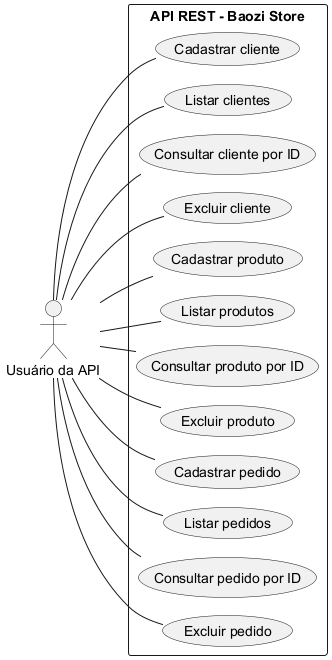

# MODELO DE TEXTO PARA PREENCHER O DOCUMENTO DA UNINTER

Preencha os campos entre colchetes, use o modelo oficial da disciplina para a entrega e exporte o documento preenchido em PDF.

## Capa
CENTRO UNIVERSITÁRIO INTERNACIONAL UNINTER  
ESCOLA SUPERIOR POLITÉCNICA  
[SEU CURSO]  
DESENVOLVIMENTO WEB BACK END  
ATIVIDADE PRÁTICA — API REST BAOZI STORE  
[SEU NOME COMPLETO] — RU: [SEU RU]  
[CIDADE] — [ESTADO]  
2026

## 1. Descrição de uma situação fictícia
A Baozi Store é uma pequena loja de pães chineses que deseja informatizar o cadastro de clientes, produtos e pedidos. Para atender essa necessidade, foi desenvolvida uma API REST utilizando Java, Spring Boot, Spring Data JPA e banco de dados relacional H2. A API permite cadastrar, listar, consultar e excluir informações.

A pessoa cliente chamada **[SEU NOME SEGUIDO DO RU — exatamente como no print do Postman]** foi cadastrada no sistema em **[DATA INFORMADA EM clienteDesde]**. O produto vendido pela loja foi o **Baozi tradicional**, com preço unitário de **R$ 12,50**, disponível para venda. Em seguida, a pessoa cliente realizou um pedido de **3 unidades**. O sistema registrou o cliente, o produto e a quantidade, relacionando os dados de forma organizada.

## 2. Diagrama caso de uso
O diagrama abaixo representa o ator principal "Usuário da API" e as operações de cadastrar, listar, consultar por ID e excluir clientes, produtos e pedidos.

## 3. Especificação da API desenvolvida
**Tecnologias:** Java 25.0.3 na execução (compilação com destino Java 17), Maven 3.10.2, Spring Boot 3.5.16, Spring Web, Spring Data JPA, banco H2, JSON, Postman e arquitetura MVC (model, repository, controller).

**Entidade Cliente:** id (Long, identificador), nome (String), clienteDesde (LocalDate).

**Entidade Produto:** id (Long, identificador), nome (String), preco (BigDecimal), estoque (Boolean, disponível ou indisponível).

**Entidade Pedido:** id (Long, identificador), clienteId (Long, chave estrangeira para Cliente), produtoId (Long, chave estrangeira para Produto), quantidade (Integer). Na implementação JPA, as associações são campos `cliente` e `produto` com `@ManyToOne`; na representação JSON são usados seus IDs.

**Endpoints (URL base http://localhost:8080):**

| Método | Endpoint | Descrição |
|---|---|---|
| POST | /clientes | Cadastrar cliente |
| GET | /clientes | Listar clientes |
| GET | /clientes/{id} | Consultar cliente |
| DELETE | /clientes/{id} | Excluir cliente |
| POST | /produtos | Cadastrar produto |
| GET | /produtos | Listar produtos |
| GET | /produtos/{id} | Consultar produto |
| DELETE | /produtos/{id} | Excluir produto |
| POST | /pedidos | Cadastrar pedido |
| GET | /pedidos | Listar pedidos |
| GET | /pedidos/{id} | Consultar pedido |
| DELETE | /pedidos/{id} | Excluir pedido |

**Exemplo de entrada para pedido:** `{ "clienteId": 1, "produtoId": 1, "quantidade": 3 }` (IDs fictícios; serão os IDs gerados em seus testes).

**Respostas HTTP.** O POST retorna 201 com o registro criado. Os GETs retornam 200 com uma lista ou um registro. O DELETE retorna 204 com corpo vazio. Entradas inválidas e tentativas de pedir produto indisponível retornam 400. Registros inexistentes, inclusive referências do pedido, retornam 404. A exclusão de cliente ou produto vinculado a pedido retorna 409. Os erros são enviados em JSON com detalhes do problema.

**Persistência e verificação.** O H2 grava os dados em arquivo em dados/baozistore.mv.db. Os dois testes automatizados do Maven passaram. Um teste cobre os 12 endpoints, o conflito de exclusão e a consulta após excluir. O outro cobre entradas inválidas, referências ausentes e produto indisponível.

Em uma execução separada, os três registros do estudo de caso foram consultados com os mesmos IDs e valores após reiniciar a API e reabrir o mesmo arquivo H2. A coleção também foi executada via Newman, com 12 requisições e 15 verificações aprovadas.

## 4. Prints do Postman
Inserir capturas **reais e legíveis** que mostrem o método, a URL, o JSON enviado quando aplicável, a resposta e o status HTTP:

1. POST /clientes — incluir nome+RU e retorno 201. **[INSERIR CAPTURA REAL]**
2. POST /produtos — incluir nome, preço, estoque e retorno 201. **[INSERIR CAPTURA REAL]**
3. POST /pedidos — incluir IDs e quantidade, retorno 201. **[INSERIR CAPTURA REAL]**
4. GET /clientes — listagem, retorno 200. **[INSERIR CAPTURA REAL]**
5. GET /produtos — listagem, retorno 200. **[INSERIR CAPTURA REAL]**
6. GET /pedidos — listagem, retorno 200. **[INSERIR CAPTURA REAL]**
7. GET /clientes/{id} — consulta individual, retorno 200. **[INSERIR CAPTURA REAL]**
8. GET /produtos/{id} — consulta individual, retorno 200. **[INSERIR CAPTURA REAL]**
9. GET /pedidos/{id} — consulta individual, retorno 200. **[INSERIR CAPTURA REAL]**
10. DELETE /pedidos/{id} — exclusão, retorno 204. **[INSERIR CAPTURA REAL]**
11. DELETE /clientes/{id} — exclusão, retorno 204. **[INSERIR CAPTURA REAL]**
12. DELETE /produtos/{id} — exclusão, retorno 204. **[INSERIR CAPTURA REAL]**

## 5. Link do repositório
O código-fonte completo do projeto está disponível em:

**[COLE AQUI O LINK REAL DO SEU REPOSITÓRIO GITHUB]**
